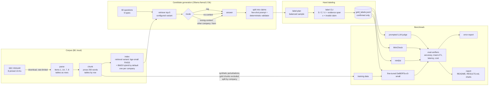

# GroundCheck

Claim-level hallucination checking for retrieval-augmented generation (RAG) over SEC
10-K filings, built and benchmarked on a laptop for $0.

## The problem

A RAG system answers questions from retrieved passages, but the answer can still say
things the passages don't: a number from the wrong year, a value off by a factor of a
thousand, a fact about the wrong segment, or a confident figure with no source at all.
On financial filings these mistakes are frequent and costly, because answers are dense
with numbers and the evidence often sits in tables. GroundCheck splits each answer into
atomic claims and labels every claim **supported**, **contradicted** or
**unsupported** by the retrieved passages, citing the evidence span. It provides a
hand-labeled, claim-level test set built from real model answers over eight 10-Ks, and
a benchmark of verifiers on it: a prompted local LLM judge, MiniCheck, HHEM and a small
fine-tuned model, compared on accuracy, latency and cost per 1,000 checks.

> **Status:** the full pipeline, labeling tools, verifiers, evaluation, report generator
> and demo are built and tested offline. **No benchmark numbers yet:** they appear below
> only after real runs on the hand-labeled set (`groundcheck report` fills them in).

## Architecture



`groundcheck pipeline` runs the whole thing in order and skips stages whose inputs
haven't changed; `groundcheck pipeline --dry-run` runs it offline with fakes in two
seconds.

## What is new here, and what isn't

Prior work this builds on, stated plainly:

- **MiniCheck** (Tang, Laban and Durrett, 2024) trains small fact-checkers on synthetic
  data to judge whether a grounding document supports a sentence, and shows they can
  approach large-LLM checkers at a fraction of the cost. GroundCheck uses MiniCheck as a
  baseline, unchanged.
- **HHEM** (Vectara's Hughes Hallucination Evaluation Model, HHEM-2.1-Open) scores
  whether a hypothesis is consistent with a premise. Also used as a baseline, unchanged.
- Rule-based perturbations of true sentences to create training negatives go back at
  least to FactCC (Kryściński et al., 2020). GroundCheck's training data follows that
  idea.

What this project adds is narrower and practical:

1. **A domain test set where these checkers are least tested:** claims about 10-K
   filings, many from financial tables, with numbers, units, scales and fiscal periods.
   Every label is a human judgment against the retrieved passages, with an exact
   evidence span and an edge-case tag (negation, rounding, units/scale, table misread,
   temporal, partial support, hedging, absent evidence).
2. **Three labels, not two.** MiniCheck and HHEM say "supported or not"; GroundCheck
   separates *contradicted* (the passage says otherwise) from *unsupported* (the
   passage doesn't say), and reports a binary view so the binary models are compared
   fairly.
3. **Natural hallucinations rather than synthetic ones in the test set:** answers are
   generated in three modes (with the right passages, closed-book, and with
   deliberately mismatched passages), so the test set holds the errors a small model
   actually makes.
4. **A full $0 benchmark on an 8 GB laptop,** including latency per claim, with any
   hosted model shown only as a clearly labeled cost estimate.

Nothing here is a new model architecture: the fine-tuned verifier is a standard
DeBERTa-v3-small classifier, and its training data is synthetic.

## Results

The section between the markers is written by `groundcheck report` from the result
files. Until a real run exists it stays TBD; nothing here is estimated.

<!-- RESULTS:START -->
*Not run yet.* Retrieval: `groundcheck eval-retrieval`. Verifiers: label claims, then
`groundcheck export-labels` and `groundcheck eval-verifiers`. Then `groundcheck report`
fills in this section, [docs/RESULTS.md](docs/RESULTS.md) and the charts.
<!-- RESULTS:END -->

**Retrieval measured so far** (manual runs before `groundcheck report` existed; kept for
reference until the report replaces them). On the 30 questions in
`data/eval/retrieval_questions.yaml`, drafted by an AI from the filings and not yet
reviewed, so differences under about 0.1 are noise:

| Variant | recall@1 | recall@5 | recall@10 |
|---|---|---|---|
| `dense` (bge-small, baseline) | 0.23 | 0.50 | 0.62 |
| `bm25` (BM25 alone, diagnostic) | 0.33 | 0.62 | 0.65 |
| other variants | TBD | TBD | TBD |

Variants and how to compare them: [docs/DESIGN.md](docs/DESIGN.md), "Retrieval variants".

## Quickstart: 8 GB MacBook Air, $0

Python 3.11+ and [Ollama](https://ollama.com/download). Everything runs locally.

```bash
git clone https://github.com/krupal2241/GroundCheck.git && cd GroundCheck
```

```bash
python3 -m venv .venv && source .venv/bin/activate
```

```bash
pip install -e ".[dev]" && make test
```

```bash
groundcheck pipeline --dry-run
```

The dry run uses synthetic filings and fake models and writes only to
`data/cache/dry-run/`. For the real thing:

```bash
pip install -e ".[dev,embed,verifiers,report]"
```

Add `rerank` (`pip install -e ".[dev,embed,rerank]"`) only to try the cross-encoder
reranker variant; the default retriever doesn't need it.

```bash
cp .env.example .env    # then set SEC_USER_AGENT="Your Name you@example.com"
```

```bash
ollama pull llama3.2:3b && groundcheck llm-info
```

```bash
groundcheck pipeline --to generate
```

That downloads the eight pinned filings (rate-limited, cached), parses, chunks, builds
the FAISS indexes for the default retrieval variant (`default` in
`config/retrieval.yaml`, under `data/index/<embedding>/`), evaluates retrieval and
generates candidates in all three modes with that retriever. Generation is resumable:
interrupt it and run the command again. On a fanless Air, `make generate` runs it in
batches of 5 with a 60-second pause. A free Colab T4 can do the generation instead
(`notebooks/generate_candidates_colab.ipynb`). `--variant NAME` picks another variant
for the index, eval-retrieval and generate stages.

**Optional: compare retrieval variants** (dense, contextual headers, hybrid BM25,
reranker, bge-base). Index every variant, then print one comparison table:

```bash
groundcheck pipeline --from index --to eval-retrieval --compare
```

(or `groundcheck index --variant all` and `groundcheck eval-retrieval --compare`). It
writes `data/eval/results/compare.json` and `compare.md`, prints the recommended default
(best recall@5, or the fastest variant within 0.05 of it), and `groundcheck report`
adds the table to docs/RESULTS.md. To adopt it, set `default:` in
`config/retrieval.yaml`, then run the pipeline again (the index stage re-runs).

Then label (see [docs/labeling_guide.md](docs/labeling_guide.md)):

```bash
groundcheck label-plan --claims 300
```

```bash
groundcheck label --plan data/labels/label_plan.json --only-unlabeled
```

```bash
groundcheck label-stats
```

And benchmark and report:

```bash
groundcheck pipeline --from export-labels
```

On 8 GB, the verifiers run one at a time (each is freed before the next loads).

## How to reproduce

| Step | Command | Output |
|---|---|---|
| Everything, skipping unchanged stages | `groundcheck pipeline` (`--from`, `--to`, `--force`) | all of the below |
| Offline rehearsal | `groundcheck pipeline --dry-run` | `data/cache/dry-run/pipeline/` |
| Retrieval eval | `groundcheck eval-retrieval` | `data/eval/results/retrieval_*.json` |
| Candidates | `python scripts/generate_candidates.py --mode {rag,no-context,wrong-context}` | `data/candidates/*.jsonl` |
| Gold set | `groundcheck label-check && groundcheck export-labels` | `data/eval/gold_labels.jsonl` |
| Verifiers | `groundcheck eval-verifiers --verifier prompted hhem minicheck` | `results/verifier_eval.{json,md}`, `results/predictions/` |
| Fine-tuned verifier | `notebooks/finetune_verifier_colab.ipynb`, then `--verifier finetuned --finetuned-path models/...` | `models/` (not committed) |
| Error analysis | `groundcheck error-report` | `results/error_report.md` |
| Report | `groundcheck report` | this README's results, `docs/RESULTS.md`, `docs/figures/` |

What pins the results: accession numbers in `config/companies.yaml`, temperature 0 and
seed 42 for the LLM, the model digest and Ollama version recorded in every candidate,
the prompt version, sha256 of the chunk file in every candidate, sha256 of the gold
file in every verifier result, and fixed seeds for sampling and training. The
committed candidate and label files are the source of truth, because a different
Ollama build can change outputs even at temperature 0.

## Limitations

- **Small test set, one annotator.** A few hundred claims labeled by one person: no
  inter-annotator agreement, and differences of a few points between verifiers are
  within noise. See [docs/THREATS_TO_VALIDITY.md](docs/THREATS_TO_VALIDITY.md).
- **AI-drafted questions.** The 60 questions (and the retrieval gold strings) were
  drafted by an AI assistant from the committed chunks, for the author to review, so
  they may be easier to retrieve than questions a real user would write.
- **One small generator.** Claims come from a 3B local model; a frontier model makes
  fewer and different mistakes.
- **Judged against retrieved passages only.** "Unsupported" means "not in the top-5
  passages", not "false"; retrieval misses show up as unsupported claims.
- **Synthetic training data** for the fine-tuned verifier; its synthetic scores
  overstate real accuracy ([docs/MODEL_CARD.md](docs/MODEL_CARD.md)).
- **MiniCheck and HHEM are binary;** their three-way scores are low by construction.
  Compare them on the supported-vs-not column.
- **English 10-Ks of eight large US companies,** one fiscal year each.

## Docs

- [docs/DESIGN.md](docs/DESIGN.md): every module, why it is built that way, and the alternatives
- [docs/RESULTS.md](docs/RESULTS.md): full results, generated by `groundcheck report`
- [docs/DATASET_CARD.md](docs/DATASET_CARD.md): how the questions, candidates and labels were made
- [docs/MODEL_CARD.md](docs/MODEL_CARD.md): the fine-tuned verifier
- [docs/THREATS_TO_VALIDITY.md](docs/THREATS_TO_VALIDITY.md): what could make the results misleading
- [docs/labeling_guide.md](docs/labeling_guide.md): label definitions and worked edge cases
- [docs/INTERVIEW_NOTES.md](docs/INTERVIEW_NOTES.md): design decisions as questions and answers
- [docs/PLAN.md](docs/PLAN.md): the original two-week plan

## Repository layout

```
src/groundcheck/   edgar, parsing, chunking, retrieval, llm, generation, labeling,
                   verify, training, pipeline, report, demo
scripts/           candidate generation, verifier fine-tuning
notebooks/         Colab: candidate generation, fine-tuning
config/            companies (pinned filings), LLM, training splits, prices (estimate only)
data/              committed: chunks, questions, candidates, labels (raw filings are not)
results/           verifier results, predictions, error report
docs/              design, results, cards, guides
tests/             pytest, fully offline (no network, no model downloads)
```

`make help` lists the common commands. A local demo (`pip install -e ".[demo]"`, then
`groundcheck demo`) shows an answer's claims with their labels and highlighted evidence
on 127.0.0.1.

## Data and fair access

Filings come from SEC EDGAR. Every request sends your `SEC_USER_AGENT`, requests are
limited to 5 per second, and every file is cached so nothing is downloaded twice. Any
paid LLM provider is refused unless `--allow-paid` is passed, and none is configured.

## License

MIT, see [LICENSE](LICENSE).
